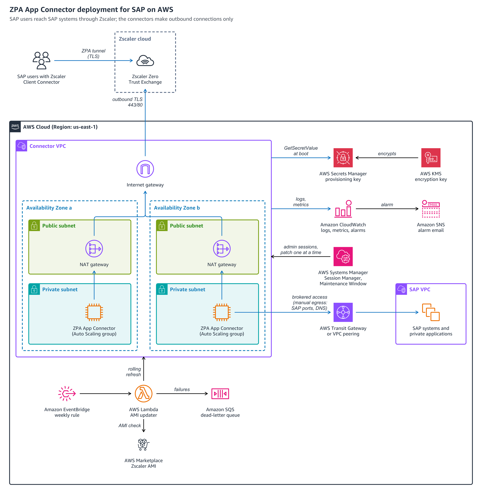

# Guidance for deploying Zscaler with SAP on AWS

This repository provides guidance and an AWS Cloud Development Kit (AWS CDK) reference implementation for Zscaler Private Access (ZPA) App Connectors on AWS. The App Connectors give SAP users and other users identity-based, private access to SAP systems and other private applications. Users need no VPN, and the applications aren't exposed to the internet.



## What this deploys

The AWS CDK app deploys a highly available App Connector fleet with the following properties:

- **Two Availability Zones**, with the connectors in private subnets and no public IP addresses.
- **An Amazon EC2 Auto Scaling group**, with a default minimum of 2, maximum of 4, and desired capacity of 4.
- **The latest Zscaler Amazon Machine Image (AMI) from AWS Marketplace**, resolved when you deploy and updated weekly.
- **The provisioning key in AWS Secrets Manager**, never in source code.
- **Weekly patching, one connector at a time**, so connectivity is never fully lost.
- **Amazon CloudWatch alarms** for the failure modes specific to the connector.

Administration is through AWS Systems Manager Session Manager. The connectors open no inbound ports, in line with Zscaler's outbound-only App Connector model.

## Prerequisites

You provide the following resources before you deploy. They're outside the scope of the AWS CDK app.

1. An Amazon Virtual Private Cloud (Amazon VPC) with **two private subnets in two Availability Zones**, each /28 or larger. For the address count, see [Subnet sizing](cdk/README.md#subnet-sizing).
2. **Outbound internet access** from each private subnet, through a regional NAT gateway, a zonal NAT gateway in each Availability Zone, or a centralized egress VPC through AWS Transit Gateway.
3. Routes from the connector subnets to your SAP and other private application VPCs, through AWS Transit Gateway or VPC peering.
4. DNS resolution of your internal application domains from the connector VPC.
5. An accepted **Zscaler ZPA App Connector** subscription in AWS Marketplace.
6. A **provisioning key** from the Zscaler ZPA Admin Portal.

For the full list, including tooling and the Auto Scaling service-linked role, see [`cdk/README.md`](cdk/README.md).

## Repository layout

The repository contains the following folders:

```text
cdk/          AWS CDK (TypeScript) app, Lambda function, precheck scripts, and architecture diagram
```

## Getting started

To configure, check, and deploy the AWS CDK app, follow [`cdk/README.md`](cdk/README.md).

## Security

The guidance follows these security practices:

- The Zscaler provisioning key is held only in AWS Secrets Manager, never in source code.
- The connectors make outbound connections only. Their security group has no inbound rules.
- All example values in this repository are placeholders. Replace them with your own.

## License

This library is licensed under the MIT-0 License. See the [LICENSE](LICENSE) file.

Zscaler, ZPA and Zscaler Private Access are trademarks of Zscaler, Inc.
