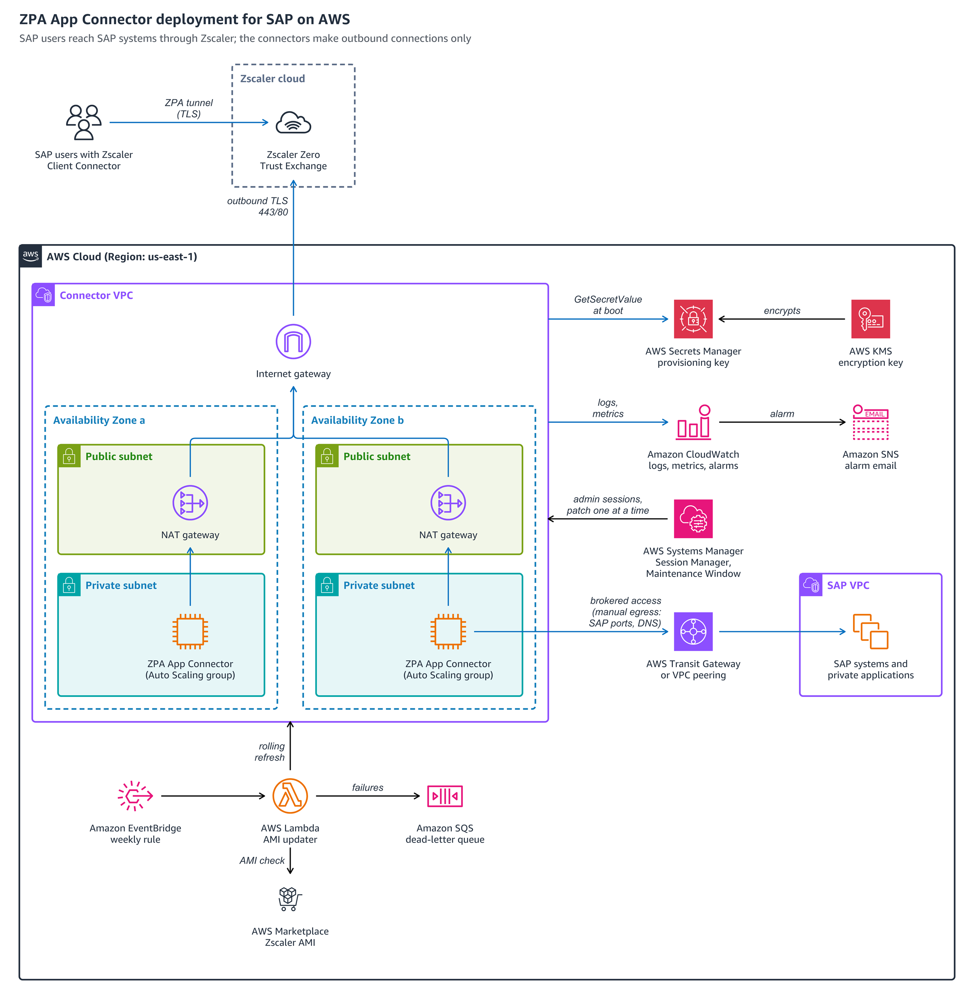

<!-- Copyright Amazon.com, Inc. or its affiliates. All Rights Reserved. -->
<!-- SPDX-License-Identifier: MIT-0 -->

# Zscaler ZPA App Connector on AWS

> **Important:** This guidance is a reference implementation. Before you deploy to production, review the AWS Identity and Access Management (IAM) policies, encryption settings, network controls, instance sizing, and patch schedules. Adapt them to your organization's security, compliance, and operational requirements.

## Overview

Zscaler Private Access (ZPA) gives users identity-based access to private applications. The applications aren't exposed to the internet, and users aren't placed on the network. **App Connectors** broker the access. They're virtual appliances that open **outbound-only** TLS tunnels to the Zscaler Zero Trust Exchange. Users reach private applications through the Zscaler cloud, which routes each request to the nearest healthy App Connector.

This AWS Cloud Development Kit (AWS CDK) app deploys a highly available App Connector fleet on AWS. The fleet has the following properties:

- **Two Availability Zones**, with the connectors in private subnets and no public IP addresses.
- **An Amazon EC2 Auto Scaling group**, configurable, with a default minimum of 2, maximum of 4, and desired capacity of 4.
- **The latest Zscaler Amazon Machine Image (AMI) from AWS Marketplace**, resolved when you deploy.
- **The provisioning key in AWS Secrets Manager**, never in code or in AWS CloudFormation state.
- **Weekly patching, one connector at a time**, so connectivity is never fully lost.
- **Amazon CloudWatch monitoring**, with alarms for the failure modes specific to the connector.
- **Administration through AWS Systems Manager Session Manager**, so the connectors open no inbound ports.

The App Connector is a single appliance role. This app automates its deployment, patching, AMI updates, and health monitoring on AWS.

## Architecture

The following diagram shows the connector fleet, the AWS services the stack uses, and the traffic flows.



The editable source is [`architecture.drawio`](architecture.drawio), and [`architecture.svg`](architecture.svg) is a scalable copy. Open the `.drawio` file with the draw.io desktop app or the draw.io extension for Visual Studio Code.

The diagram shows the following flows:

- **User access:** Users run the Zscaler Client Connector, which connects them to the Zscaler Zero Trust Exchange. The Zero Trust Exchange sends each session to an App Connector.
- **Outbound only:** Each App Connector runs in a private subnet. It reaches the Zscaler cloud on TCP 443 and 80 through a NAT gateway, or through a centralized egress VPC.
- **Application access:** The connector reaches the SAP systems and other private applications through AWS Transit Gateway or Amazon Virtual Private Cloud (Amazon VPC) peering.
- **Supporting services:**
  - At boot, each connector reads the provisioning key from AWS Secrets Manager.
  - An AWS Key Management Service (AWS KMS) key encrypts the key and the logs.
  - The connectors send logs and metrics to Amazon CloudWatch, which sends alarms through Amazon Simple Notification Service (Amazon SNS).
  - AWS Systems Manager provides Session Manager access and the weekly patch window.
  - Each week, an Amazon EventBridge rule runs an AWS Lambda function. The function checks AWS Marketplace for a newer AMI and rolls it in. Failed runs land in an Amazon Simple Queue Service (Amazon SQS) dead-letter queue.

## Repository layout

The repository contains the following files:

```text
bin/cdk-zpa-connector.ts     App entry: loads the configuration, creates the stack
lib/config.ts                Typed configuration loader and validation (from cdk.json context)
lib/zpa-connector-stack.ts   The stack: IAM, security group, launch template, Auto Scaling group,
                             secret, patching, AMI updater, monitoring
lambda/zpa_ami_updater.py    Weekly latest-AMI check and rolling instance refresh
scripts/precheck.sh          Read-only prerequisite check (Linux, macOS, AWS CloudShell)
scripts/precheck.ps1         Read-only prerequisite check (Windows)
architecture.drawio          Editable architecture diagram (.png and .svg exported from it)
cdk.json                     Context defaults (the "zpa" block)
```

## Prerequisites

You need the following tools and AWS resources before you deploy.

### Tooling

Your workstation needs the following tools:

- **Node.js 22 or later**, with npm.
- **The AWS Command Line Interface (AWS CLI) version 2**, signed in to the target account (`aws sso login` or a configured profile).
- **The AWS CDK CLI.** It's a development dependency of this project, so you run it with `npx cdk`.

### AWS prerequisites that this app does not create

Put the following resources in place first. The precheck scripts (`scripts/precheck.sh` and `scripts/precheck.ps1`) verify them.

| Prerequisite | Requirement |
|---|---|
| **VPC** | An Amazon VPC with DNS support and DNS hostnames turned on, large enough for its subnets. For example, a /26 holds two /28 private subnets and two /28 public subnets for zonal NAT gateways. |
| **Private subnets** | Exactly two, in two different Availability Zones, each /28 or larger. See [Subnet sizing](#subnet-sizing). |
| **Outbound internet** | Each private subnet needs a default route to the internet. Use a regional NAT gateway, a zonal NAT gateway in each Availability Zone, or a centralized egress VPC through AWS Transit Gateway. A regional NAT gateway or a centralized egress VPC needs no public subnet in the connector VPC. Interface endpoints alone aren't enough, because the connector needs general outbound access to the Zscaler cloud. |
| **Routing to workloads** | Routes from the connector subnets to the private application VPCs, through Transit Gateway or VPC peering. Accept the attachments, and add the return routes. |
| **DNS** | The connector VPC must resolve the internal application domains. Use Amazon Route 53 Resolver conditional forwarding or a DNS forwarder. If the VPC uses your own DNS servers, add DNS egress to them after deployment (see Step 4.5). |
| **AWS Marketplace subscription** | Accept the Zscaler ZPA App Connector subscription, product code `by1wc5269g0048ix2nqvr0362`. You do this once for each account, on the console, because there's no API to accept the terms. Without it, the Auto Scaling group can't launch instances. The subscription is free on [the AWS Marketplace listing](https://aws.amazon.com/marketplace/pp?sku=by1wc5269g0048ix2nqvr0362). |
| **ZPA Admin Portal** | A provisioning key, with a reuse limit equal to or greater than the Auto Scaling group maximum size. |
| **Auto Scaling service-linked role** | `AWSServiceRoleForAutoScaling` must exist. The AWS KMS key policy names it, and AWS KMS rejects a policy that names a role that doesn't exist yet. AWS creates the role the first time you use an Auto Scaling group in the account. In a new account, create it once with `aws iam create-service-linked-role --aws-service-name autoscaling.amazonaws.com`. |

### Subnet sizing

Size each private subnet for what it holds. Amazon VPC reserves five addresses in every subnet, so a /28 leaves 11 usable addresses. With the default `maxCapacity` of 4, one /28 subnet holds the following:

- Up to four connectors, when the other Availability Zone is unavailable.
- One more connector while Amazon EC2 Auto Scaling replaces or rebalances instances.
- One network interface for the AMI updater Lambda function, which runs in the same subnets.
- One network interface each for a Route 53 Resolver outbound endpoint and a Transit Gateway attachment, if you place them in these subnets.

Use /27 or larger if you raise `maxCapacity`, or if you add interface VPC endpoints or other workloads to these subnets. Amazon VPC doesn't allow a subnet smaller than /28, so a /29 isn't an option. For details, see [Subnet CIDR blocks](https://docs.aws.amazon.com/vpc/latest/userguide/subnet-sizing.html) in the *Amazon VPC User Guide*.

## Deployment

The following steps deploy the stack and bring the connectors online.

### Step 0: Run the precheck (read-only)

The precheck verifies the prerequisites without changing anything. Run the version for your platform:

```bash
# Linux, macOS, or AWS CloudShell
scripts/precheck.sh --profile <profile> --region <region> --vpc <vpc-id> --subnets <subnet-a>,<subnet-b>
```

```powershell
# Windows
scripts\precheck.ps1 -Profile <profile> -Region <region> -Vpc <vpc-id> -Subnets "<subnet-a>,<subnet-b>"
```

### Step 1: Install and configure

The following command installs the project dependencies:

```bash
npm ci
```

Set your values in the `zpa` block of `cdk.json`, or pass `-c zpa:<key>=<value>` when you deploy.

### Step 2: Synthesize and review

The following command synthesizes the stack with your values:

```bash
npm run synth -- \
  -c zpa:account=<id> -c zpa:region=<region> -c zpa:vpcId=<vpc> \
  -c zpa:privateSubnetIds=<subnet-a>,<subnet-b> -c zpa:alarmEmail=<you@example.com>
```

The configuration loader validates the values and stops at the first problem. For example, it rejects a list that doesn't have exactly two subnets, or alarms turned on with no email address. The precheck confirms that the two subnets are in different Availability Zones.

### Step 3: Bootstrap and deploy

Each account and Region needs a one-time AWS CDK bootstrap. The following commands bootstrap, review, and deploy:

```bash
npx cdk bootstrap aws://<id>/<region>   # once for each account and Region
npx cdk diff
npx cdk deploy
```

Amazon SNS sends a subscription confirmation to `alarmEmail`. Confirm it, or the alarms deliver no email.

### Step 4: Populate the provisioning key

The stack creates the Secrets Manager secret with the placeholder value `REPLACE_WITH_ZPA_PROVISIONING_KEY`. Until you replace it, the connectors fail enrollment with HTTP 401. The following commands put the real key and refresh the fleet:

```bash
aws --profile <profile> --region <region> secretsmanager put-secret-value \
  --secret-id zpa-connector --secret-string '<ZPA_PROVISIONING_KEY>'

aws --profile <profile> --region <region> autoscaling start-instance-refresh \
  --auto-scaling-group-name <AsgName-from-outputs> \
  --preferences '{"MinHealthyPercentage":50,"InstanceWarmup":300}'
```

### Step 4.5: Add backend application and DNS egress (manual)

The stack's security group allows outbound traffic to the **Zscaler cloud** on TCP 443 and 80 only. It doesn't allow traffic to the **backend applications** that the fleet brokers to, or to your **DNS servers**. Only you know those ports and CIDRs, and a wrong guess built into the template is worse than an explicit, reviewed rule. The backend rule is always required. The DNS rule depends on how the VPC resolves names.

The App Connector **opens** the session to the backend. Without this rule, it drops its own outbound packets, and the application is unreachable even though enrollment succeeds. The Zscaler and AWS Deployment Guide requires this rule too (Deploy App Connectors, step 12). It asks for egress *"along with any required ports to access the applications the App Connector supports."*

Confirm the backend supernet CIDRs and ports with the application owner. Examples are RDP 3389, SSH 22, HTTPS 443, and database ports. Then add the rule to the security group in the `SecurityGroupId` stack output. The following command allows all traffic to the backend supernet:

```bash
aws --profile <profile> --region <region> ec2 authorize-security-group-egress \
  --group-id <SecurityGroupId-from-outputs> \
  --ip-permissions "IpProtocol=-1,IpRanges=[{CidrIp=<BACKEND_SUPERNET_CIDR>,Description=backend apps}]"
```

For a tighter rule, allow only the required ports. Don't send backend egress to `0.0.0.0/0`.

The connectors must resolve the DNS names of the target SAP systems. Check the DHCP options set of the connector VPC to decide whether you need a DNS rule:

- **AmazonProvidedDNS:** no rule is needed. Security groups don't filter traffic to the Amazon-provided DNS server. The connectors reach the Route 53 Resolver and its forwarding rules without a rule.
- **Your own DNS servers** (for example, Active Directory domain controllers or on-premises DNS): add UDP and TCP 53 egress to each DNS server. TCP 53 covers large responses.

The following command adds DNS egress to one DNS server. Repeat it for each server:

```bash
aws --profile <profile> --region <region> ec2 authorize-security-group-egress \
  --group-id <SecurityGroupId-from-outputs> \
  --ip-permissions "IpProtocol=udp,FromPort=53,ToPort=53,IpRanges=[{CidrIp=<DNS_SERVER_IP>/32,Description=DNS}]" \
                   "IpProtocol=tcp,FromPort=53,ToPort=53,IpRanges=[{CidrIp=<DNS_SERVER_IP>/32,Description=DNS}]"
```

If the backend rule already allows all traffic to a supernet that contains the DNS servers, it covers DNS too. Don't send DNS egress to `0.0.0.0/0`.

### Step 5: Verify

Check the fleet with the following steps:

- In the ZPA Admin Portal, choose **Private Infrastructure**, **App Connectors**. The connectors show as **connected** in the right group and location.
- In CloudWatch, the `/zpa/connector` log group receives a `messages` and a `user-data` stream for each instance. All alarms are in the **OK** state.
- Terminate one connector. The Auto Scaling group replaces it, and the new connector enrolls without manual steps.

### Redeploying: refresh the cached AMI

The AWS CDK caches the AWS Marketplace AMI lookup in `cdk.context.json` the first time you synthesize. It reuses that AMI ID on every later `cdk synth` and `cdk deploy`, even after Zscaler publishes a newer image. Between deployments, the AMI-updater Lambda function moves the running fleet to newer AMIs, through new launch template versions.

A redeploy with a stale cache makes CloudFormation write the older AMI back into the launch template. The next instance refresh or scale-out then launches the **older** image. Before any redeploy, clear the cached lookup with the following commands:

```bash
# List the context values. Note the number (#) of the entry whose key starts with "ami:account=".
npx cdk context

# Reset only that entry. Replace <N> with the number shown, or pass the full key in quotes.
npx cdk context --reset <N>

# Synthesize, and confirm that the launch template has the AMI ID you expect.
npx cdk synth
```

The following command shows the current AMI:

```bash
aws ec2 describe-images --owners aws-marketplace \
  --filters "Name=product-code,Values=<zpaProductCode>" "Name=state,Values=available" \
  --query "sort_by(Images,&CreationDate)[-1].[ImageId,Name,CreationDate]" --output table
```

Deleting `cdk.context.json` also works, but it clears the cached VPC lookup too. `cdk.context.json` is excluded from version control (`.gitignore`), because it holds account-specific values.

**Don't change the connector security group description**. CloudFormation can't change a security group description in place, so an edit replaces the group on every existing deployment. The new group doesn't have the backend egress you added in Step 4.5. The connectors then lose access to the applications until you add the rule again. Run `npx cdk diff` before every redeploy, and confirm that `ConnectorSg` isn't marked `replace`. The description still mentions DNS to `0.0.0.0/0`, which is out of date, but it stays unchanged for this reason.

### Parameters

The following table lists the context keys, their defaults, and what they control.

| Parameter (context key) | Required | Default | Description |
|---|---|---|---|
| `account` | **Yes** | | Target AWS account ID. |
| `region` | **Yes** | | AWS Region, for example `us-east-1`. |
| `vpcId` | **Yes** | | Existing VPC to deploy into. |
| `privateSubnetIds` | **Yes** | | Exactly two private subnets in two Availability Zones, as a comma-separated list or a JSON array. |
| `minCapacity` | No | `2` | High availability floor, one connector for each Availability Zone. |
| `maxCapacity` | No | `4` | Upper scaling bound. |
| `desiredCapacity` | No | `4` | Steady-state fleet size. |
| `instanceType` | No | `m5a.large` | Zscaler's production recommendation. For low traffic, `m5a.xlarge` and `t3.xlarge` also work. |
| `volumeSizeGiB` | No | `80` | Root gp3 volume. The AMI updater grows it if a future AMI needs more space. |
| `secretName` | No | `zpa-connector` | Provisioning-key secret. The stack creates it with a placeholder, so the name must not exist yet. It's retained when you delete the stack. |
| `encryptionKeyType` | No | `customer-managed` | Encryption for the secret, root volumes, log group, alarm topic, and dead-letter queue. `customer-managed` (default) uses one AWS KMS customer managed key with rotation. `aws-managed` uses AWS managed and AWS owned keys. It needs the `AWSServiceRoleForAutoScaling` role (see Prerequisites). |
| `patchGroup` | No | `zpa-sequential` | Tag that binds connectors to the one-at-a-time patch path. |
| `enableAmiUpdater` | No | `true` | Provision the weekly AMI-updater Lambda function and EventBridge rule. |
| `enablePatching` | No | `true` | Provision the weekly sequential Systems Manager Maintenance Window. |
| `enableAlarms` | No | `true` | Provision the CloudWatch alarms and the Amazon SNS topic. |
| `alarmEmail` | If alarms | | Email address subscribed to the alarm topic. Required when `enableAlarms=true`. |
| `patchWindowCron` | No | `cron(0 3 ? * SAT *)` | Patch Maintenance Window schedule, in UTC. The default is a placeholder. Set your own window, outside your peak SAP usage and away from `amiUpdaterCron`. |
| `amiUpdaterCron` | No | `cron(0 0 ? * SUN *)` | AMI check schedule, in UTC. |
| `zpaProductCode` | No | `by1wc5269g0048ix2nqvr0362` | AWS Marketplace product code of the Zscaler ZPA App Connector. |

## Key design decisions

The stack makes the following design decisions:

1. **An outbound-only security group, with two egress classes.** App Connectors need no inbound access, so the security group has **no inbound rule**. Egress is split into two classes:
   - **The Zscaler cloud (managed by the stack):** **TCP 80 and 443** to **`0.0.0.0/0`**, by design. Zscaler doesn't publish a stable IP address list for App Connector destinations. The connector reaches the *nearest* Zscaler broker or Service Edge, and those endpoints change over time and by Region. Zscaler's guidance is based on ports and domains, not CIDRs, so a fixed CIDR list would break connectivity. The compensating controls are no inbound access, egress on the required ports only, and TLS on all outbound cloud traffic.
   - **The backend applications and DNS (manual, after deployment):** the ports and CIDRs of the private applications that the fleet brokers to. If the VPC doesn't use AmazonProvidedDNS, this class also includes UDP and TCP 53 to your DNS servers. The stack doesn't create these rules, because only the operator knows the values. The `ManualBackendEgressStep` stack output gives the security group ID and an example command (see Step 4.5). The Zscaler guide requires this egress in addition to the cloud ports. Scope it to the backend supernet and the DNS server addresses, not `0.0.0.0/0`.

2. **Session Manager for administration.** There's no SSH key, no bastion host, and no inbound port 22. Break-glass access is through Session Manager, which AWS CloudTrail audits.

3. **The latest AWS Marketplace AMI, at deployment and at run time.** The stack resolves the newest AMI by product code when you synthesize. The AMI-updater Lambda function keeps the running fleet current each week:
   - It builds each new launch template version from the version that the Auto Scaling group runs, then makes it the default version.
   - It starts an instance refresh pinned to the new version, at a minimum healthy percentage of 75 and a maximum of 125.
   - Both the lookup and the function filter on owner `aws-marketplace` and the Zscaler product code. So only Zscaler images published in AWS Marketplace qualify.

   The synthesized result is cached in `cdk.context.json`. See [Redeploying: refresh the cached AMI](#redeploying-refresh-the-cached-ami).

4. **The provisioning key only in Secrets Manager.** The key never appears in the launch template, the AWS CDK code, or the CloudFormation state:
   - At boot, the user data reads the key through a role scoped to the exact secret ARN. The secret is retained when you delete the stack, so the key isn't lost.
   - With the default `customer-managed`, one AWS KMS key with automatic rotation encrypts five resources. They're the secret, the root volumes, the `/zpa/connector` log group, the alarm topic, and the dead-letter queue. The root volumes hold the key on disk at `/opt/zscaler/var/provision_key`. The key policy lets the Amazon EC2 Auto Scaling service-linked role use the key.
   - With `-c zpa:encryptionKeyType=aws-managed`, the stack uses AWS managed and AWS owned keys instead. They're `aws/secretsmanager`, the account default Amazon Elastic Block Store (Amazon EBS) key, the CloudWatch Logs key, and the SQS key. Root volumes stay encrypted in both modes. When alarms are on, the stack still creates a small key for the alarm topic. CloudWatch alarms can't publish to a topic encrypted with the AWS managed `aws/sns` key.
   - **Automatic secret rotation is off, by design.** The value is a provisioning key that Zscaler issues and you manage in the ZPA Admin Portal. AWS can't rotate it. To change it, reissue it in the portal, run `put-secret-value`, and refresh the fleet.

5. **Patching one connector at a time.** A dedicated Systems Manager Maintenance Window runs `AWS-RunPatchBaseline` with `MaxConcurrency=1` and `MaxErrors=0`, against the `PatchGroup` tag. Each connector is patched and rebooted, and must return before the next one starts. In a fleet of 2, at most one Availability Zone loses its connector, and only briefly.

6. **A clean enrollment at boot, and an alarm for the backoff**. The user data clears the stale OAuth enrollment state that the AMI leaves at first boot. Then it restarts the connector once, so the connector reads the provisioning key. Without this step, the connector waits for an interactive sign-in and never enrolls. The user data doesn't retry enrollment. After 5 consecutive failures, a Zscaler App Connector enters a **6-hour backoff**. The enrollment-backoff alarm pages on the first occurrence. To recover, fix the cause, then restart the connector through Session Manager with `systemctl restart zpa-connector`.

7. **IMDSv2 required.** The launch template requires Instance Metadata Service Version 2 (`HttpTokens=required`).

8. **A gp3 root volume.** Cost-efficient baseline storage with fixed IOPS. The AMI updater grows the volume if a newer AMI's snapshot is larger.

9. **Configuration that fails fast.** The typed configuration loader validates inputs when you synthesize. It checks for two subnets, a minimum capacity of at least 2, and an alarm email when alarms are on. So misconfigurations surface before any resource is created.

## Security

The following table lists the security controls.

| Control | Description |
|---|---|
| **No inbound access** | The connector security group has no inbound rules. App Connectors make outbound connections only. |
| **Restricted egress** | The stack allows egress on TCP 80 and 443 for the Zscaler cloud only. You add backend and, if required, DNS egress, scoped to known CIDRs. The 80 and 443 destination is `0.0.0.0/0` because Zscaler publishes no fixed IP address list for App Connectors. The control is the port restriction and TLS, not the CIDR. |
| **Session Manager administration** | Administration through Session Manager, with no SSH, no bastion host, and no key pair. |
| **Least-privilege IAM** | The instance role grants `secretsmanager:GetSecretValue` on the exact secret ARN, plus the managed policies for Systems Manager, the CloudWatch agent, and patching. The AMI-updater role can change only this stack's launch template and Auto Scaling group. Its `ec2:RunInstances` and `iam:PassRole` permissions are limited to this launch template and to the connector role. |
| **Secret handling** | The provisioning key is held only in Secrets Manager, read at boot, and never in code or state. The secret is retained when you delete the stack. |
| **Encryption at rest** | With the default `encryptionKeyType=customer-managed`, one AWS KMS customer managed key with rotation encrypts the secret, root volumes, log group, alarm topic, and dead-letter queue. With `aws-managed`, AWS managed and AWS owned keys are used instead. Root volumes are encrypted in both modes. |
| **cdk-nag** | Every `cdk synth` and `cdk deploy` runs the cdk-nag AWS Solutions rule pack. It writes a report to `cdk.out/AwsSolutions-*-NagReport.csv`. Each accepted finding carries an inline `NagSuppressions` reason next to the resource. Any new finding without a suppression fails the synth. |
| **Secret rotation** | **Off, by design.** Zscaler issues the provisioning key, and you manage it in the ZPA Admin Portal. AWS can't rotate it. To change it, reissue it in the portal, run `put-secret-value`, and refresh the fleet. |
| **IMDSv2 required** | The launch template requires IMDSv2 tokens. |
| **Encryption in transit** | All connector traffic to the Zscaler cloud uses TLS. |
| **Continuous patching** | Weekly operating system patching and weekly AMI updates, both applied one connector at a time. |

## Monitoring and alerting

The CloudWatch agent ships `/var/log/messages`, which holds the connector journal, and `/var/log/user-data.log` to the `/zpa/connector` log group, with host metrics. Its configuration is in Systems Manager Parameter Store at `/zpa/cloudwatch-agent/config`. Two metric filters, in the `ZPA/Connector` namespace, feed the alarms in the following table.

| Alarm | Condition | Severity |
|---|---|---|
| **Enrollment backoff** | The log shows `re-enrollment in 6 hours` once or more in any of the last three 5-minute periods | **Page.** A connector is stuck for up to 6 hours. |
| **Fleet under minimum** | `GroupInServiceInstances` under `minCapacity` for 5 consecutive minutes | **Page.** |
| **Repeated OAuth 401** | 3 or more OAuth 401 responses in one 10-minute period | **Notify.** Suspect the provisioning key. |

Alarms publish to an Amazon SNS topic subscribed to `alarmEmail`. The ZPA Admin Portal remains the source of truth for connector health on the Zscaler side. These alarms catch the AWS side failures quickly.

## Cost estimate

The following table estimates the monthly cost of a fleet of 4 `m5a.large` connectors in one Region, at On-Demand prices. All amounts are in US dollars (USD), and prices vary by Region and usage.

| Component | Estimate | Basis |
|---|---|---|
| Amazon EC2 (4 m5a.large instances, all month) | About $250 to $280 | About $0.086 an hour, for 4 instances, for 730 hours |
| Amazon EBS (4 volumes of 80 GB gp3) | About $26 | $0.08 for each GB-month |
| NAT gateways (2) | About $65, plus data | $0.045 an hour, for 2 gateways, for 730 hours, plus processing |
| CloudWatch (logs, metrics, alarms) | About $5 to $10 | Connector logs and a few alarms |
| Lambda (AMI updater) | Less than $1 | Weekly invocation |
| Secrets Manager | About $0.40 | 1 secret |
| AWS KMS (default customer managed key; with `aws-managed`, only the alarm-topic key remains when alarms are on) | About $1, plus usage | $1 for each key-month, plus $0.03 for each 10,000 requests |
| **Total** | **About USD 350 to 390 a month** | Excludes cross-VPC and Transit Gateway data, and Zscaler licensing |

A fleet of 2 roughly halves the Amazon EC2 and Amazon EBS lines. For precise figures, use the [AWS Pricing Calculator](https://calculator.aws/). Zscaler ZPA licensing is separate, and isn't an AWS charge.

## Clean up

The following command deletes the stack:

```bash
npx cdk destroy
```

The stack retains three resources on purpose: the provisioning-key secret, the AWS KMS customer managed key, and the `/zpa/connector` log group. Delete them separately when you no longer need them. The key has a waiting period before it's deleted. A redeploy fails while a retained secret or log group with the same name exists. Before you redeploy, delete the log group, and delete the secret or choose a different `secretName`.

## Notices

Customers are responsible for making their own independent assessment of the information in this Guidance. This Guidance: (a) is for informational purposes only, (b) represents AWS current product offerings and practices, which are subject to change without notice, and (c) does not create any commitments or assurances from AWS and its affiliates, suppliers or licensors. AWS products or services are provided "as is" without warranties, representations, or conditions of any kind, whether express or implied. AWS responsibilities and liabilities to its customers are controlled by AWS agreements, and this Guidance is not part of, nor does it modify, any agreement between AWS and its customers.

## License

This library is licensed under the MIT-0 License. See the [LICENSE](LICENSE) file.

Zscaler, ZPA and Zscaler Private Access are trademarks of Zscaler, Inc. Use of the Zscaler App Connector AMI from AWS Marketplace is subject to Zscaler's own license terms and subscription.
